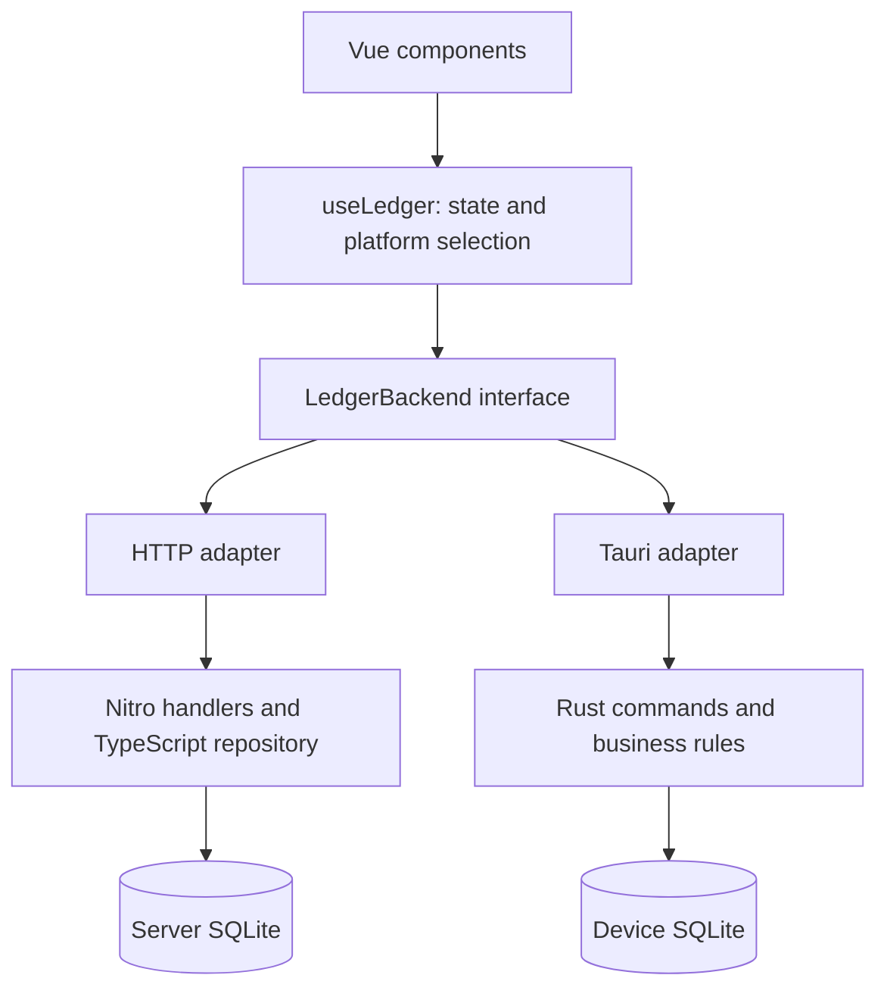

# Architecture

[Home](../README.md) · [简体中文](../README.zh-CN.md) · [Development](development.md)

PocketLedger shares a Vue interface across Web and Tauri. Business rules are implemented separately in TypeScript and Rust; each installation has an independent ledger.

## Data paths



`NUXT_TAURI=true` or a Tauri platform environment selects the client build. Nuxt disables SSR and generates `.output/public`; Tauri embeds those static assets, not Nitro or the server database.

Five dynamically selected components provide navigation. `useLedger` uses Nuxt `useState`, computes summaries, and selects a `LedgerBackend` once when created. Each operation delegates to that interface. The HTTP adapter preserves API methods and payloads; the Tauri adapter lazily loads native IPC. Initial loading uses the same backend, with SSR enabled only for Web.

## Source map

| Location | Responsibility |
| --- | --- |
| `app/app.vue` | Application shell and navigation |
| `app/components/` | Dashboard, accounts, transactions, reports, settings |
| `app/composables/useLedger.ts` | State, statistics, errors, and backend selection |
| `app/composables/useLocale.ts` | Reactive Chinese/English UI messages and interpolation |
| `app/services/ledger/` | Backend contract, HTTP adapter, Tauri adapter |
| `app/utils/ledgerBackup.ts` | Export formats, backup parsing, browser/native file access |
| `server/api/` | Nitro HTTP handlers |
| `server/utils/` | SQLite, migrations, validation, business operations |
| `shared/types/ledger.ts` | TypeScript models and schema/backup constants |
| `src-tauri/src/lib.rs` | Application setup and command registration |
| `src-tauri/src/models.rs` | Serializable contracts and application state |
| `src-tauri/src/database.rs` | Schema initialization and migrations |
| `src-tauri/src/validation.rs` | Input validation and decimal conversion |
| `src-tauri/src/repository.rs` | Accounting operations and transactions |
| `src-tauri/src/backup.rs` | Automatic snapshots and backup file access |
| `src-tauri/src/commands.rs` | IPC boundary, database locking, pre-change backups |
| `src-tauri/src/tests.rs` | Rust regressions and shared backend fixtures |
| `src-tauri/gen/android/` | Android host and Gradle configuration |
| `tests/` | TypeScript tests and shared backend fixtures |

## Accounting and storage

The main tables are `accounts`, `transactions`, and a single-row `settings` table. Web uses `better-sqlite3`; Tauri uses `rusqlite` with bundled SQLite and a mutex-protected connection. Both enable WAL and foreign keys.

Money is stored as decimal text. TypeScript uses `decimal.js` and Rust uses `rust_decimal` for stored balance calculations:

```text
balance = opening balance + income − expenses
```

Frontend totals and conversions still use JavaScript numbers and fixed demonstration rates. Transfers create linked entries transactionally and are excluded from ordinary income/expense summaries. Accounts with linked transactions cannot be deleted through the business layer.

Web defaults to `data/accounting.sqlite`, overridden by `NUXT_DATABASE_PATH`. Tauri uses its application data directory. The application identifier remains unchanged after rebranding to preserve the data location.

## Migrations and backups

- Schema version **3**, stored in `PRAGMA user_version`; backup format version **1**.
- The backup identifier remains `accounting-tool-backup` for compatibility.
- Migrations run sequentially in transactions. Newer unsupported schemas are rejected.
- Version 2 adds opening balances and transfer identifiers; opening balances are derived from existing balances and transactions.
- Version 3 adds the persisted interface language; existing databases and older JSON backups default to Simplified Chinese.
- JSON restore validates versions, IDs, currencies, and relationships, then replaces the ledger transactionally. The UI requires saving the current ledger before proceeding.
- Automatic pre-change JSON snapshots live in `automatic-backups` next to the Web database or inside the Tauri app data directory. Seven files are retained; amounts are unmasked.
- JSON is the full restore format. Excel exports contain explanation, accounts, transactions, and settings sheets; CSV distinguishes record types. Neither supports import yet.

There is no automatic sync, merge restore, or legacy MySQL importer. The previous Spring Boot implementation remains in Git history; old MySQL data requires a separately designed migration.

## HTTP API

| Method | Path | Purpose |
| --- | --- | --- |
| GET / DELETE | `/api/ledger` | Read / clear ledger |
| POST | `/api/ledger/restore` | Restore validated JSON |
| GET | `/api/ledger/automatic-backup` | Read latest automatic backup |
| GET / POST | `/api/ledger/integrity` | Check / repair balances |
| GET / POST | `/api/accounts` | List / create accounts |
| PUT / DELETE | `/api/accounts/:id` | Edit / remove account |
| PUT | `/api/accounts/reorder` | Save ordering |
| GET / POST | `/api/transactions` | List / create transactions |
| PUT / DELETE | `/api/transactions/:id` | Edit / remove transaction |
| POST | `/api/transfers` | Same-currency transfer |
| PUT | `/api/settings` | Save preferences |

There is no built-in authentication or per-user isolation. Tauri production CSP limits external connections; network integrations require reviewing that configuration.
