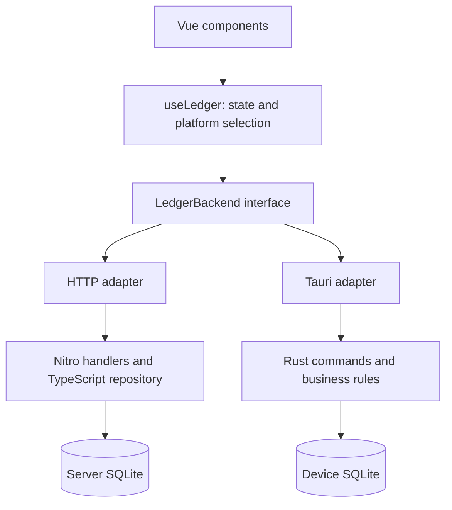

# Architecture

[Home](../README.md) · [简体中文](../README.zh-CN.md) · [Development](development.md)

PocketLedger shares a Vue interface across Web and Tauri. Business rules are implemented separately in TypeScript and Rust; each installation has an independent ledger.

## Data paths



`NUXT_TAURI=true` or a Tauri platform environment selects the client build. Nuxt disables SSR and generates `.output/public`; Tauri embeds those static assets, not Nitro or the server database.

Five dynamically selected components provide navigation: dashboard, reports, transaction entry, accounts, and settings. The dashboard includes a monthly statement below the account overview and asset allocation. `useLedger` uses Nuxt `useState`, computes summaries, and selects a `LedgerBackend` once when created. Each operation delegates to that interface. The HTTP adapter preserves API methods and payloads; the Tauri adapter lazily loads native IPC. Initial loading uses the same backend, with SSR enabled only for Web.

Asset and monthly income/expense summary cards appear only on the dashboard. Native mobile builds select a safe-area-aware bottom navigation bar using `TAURI_ENV_PLATFORM`; Web and desktop builds retain their existing sidebar/responsive navigation.

Home provides a selectable monthly statement. The five main navigation items are Home, Reports, Add entry, Accounts, and Settings. Add entry contains income/expense entry and transfers. Reports has separate Transactions and Statistics subpages, with Transactions shown by default. Statistics contains annual income/expense bars, daily spending, ranked categories, and monthly totals; Transactions shows the latest eight recorded dates. View more opens months ordered newest first; each month expands to daily entries. Account and keyword filters apply to both views. Day, month, and overall totals use decimal arithmetic and exclude transfers while retaining their entries in details. The selected subpage is retained when opening an entry for editing and returning to Reports. Home and Reports share a year/month picker and selected period; editing a report transaction opens the Add entry page with the record prefilled. The Add entry component is cached across navigation to retain unsaved drafts. Surplus means income minus expenses in the selected month, not a historical account balance; current net worth is labeled separately. Transfers are excluded, and displayed amounts, chart labels, and tooltips respect amount masking.

## Source map

| Location | Responsibility |
| --- | --- |
| `app/app.vue` | Application shell and navigation |
| `app/components/` | Dashboard with ledger charts, accounts, transactions, settings |
| `app/composables/useLedger.ts` | State, statistics, errors, and backend selection |
| `app/composables/useLocale.ts` | Reactive Chinese/English UI messages and interpolation |
| `app/services/ledger/` | Backend contract, HTTP adapter, Tauri adapter |
| `app/utils/ledgerBackup.ts` | Export formats, backup parsing, browser/native file access |
| `app/utils/ledgerHistory.ts` | Date/month grouping, latest eight recorded dates, and transfer-aware decimal totals |
| `app/utils/ledgerReports.ts` | Shared monthly/yearly totals, daily spending, category rankings, and period navigation |
| `server/api/` | Nitro HTTP handlers |
| `server/utils/` | SQLite, migrations, validation, business operations |
| `shared/types/ledger.ts` | TypeScript models and schema/backup constants |
| `src-tauri/src/lib.rs` | Application setup and command registration |
| `src-tauri/src/models.rs` | Serializable contracts and application state |
| `src-tauri/src/database.rs` | Schema initialization and migrations |
| `src-tauri/src/validation.rs` | Input validation and decimal conversion |
| `src-tauri/src/repository.rs` | Accounting operations and transactions |
| `src-tauri/src/backup.rs` | Automatic snapshots and backup file access |
| `src-tauri/src/commands.rs` | IPC boundary, database locking, pre-change backups |
| `src-tauri/src/tests.rs` | Rust regressions and shared backend fixtures |
| `src-tauri/gen/android/` | Android host and Gradle configuration |
| `tests/` | TypeScript tests and shared backend fixtures |

## Accounting and storage

The main tables are `accounts`, `transactions`, and a single-row `settings` table. Web uses `better-sqlite3`; Tauri uses `rusqlite` with bundled SQLite and a mutex-protected connection. Both enable WAL and foreign keys.

Money is stored as decimal text. TypeScript uses `decimal.js` and Rust uses `rust_decimal` for stored balance calculations:

```text
balance = opening balance + income − expenses
```

Dashboard totals and currency conversions use JavaScript numbers and fixed demonstration rates; monthly reports accumulate converted amounts with `decimal.js`. Transfers create linked entries transactionally and are excluded from ordinary income/expense summaries. Accounts with linked transactions cannot be deleted through the business layer.

Web defaults to `data/accounting.sqlite`, overridden by `NUXT_DATABASE_PATH`. Tauri uses its application data directory. The application identifier remains unchanged after rebranding to preserve the data location.

## Migrations and backups

- Schema version **4**, stored in `PRAGMA user_version`; backup format version **1**.
- The backup identifier remains `accounting-tool-backup` for compatibility.
- Migrations run sequentially in transactions. Newer unsupported schemas are rejected.
- Version 2 adds opening balances and transfer identifiers; opening balances are derived from existing balances and transactions.
- Version 3 adds the persisted interface language; existing databases and older JSON backups default to Simplified Chinese.
- Version 4 adds optional original import provenance on transactions. Older databases migrate without changing balances or entries.
- Restore validates versions, IDs, currencies, and relationships, then replaces the ledger transactionally after an inline confirmation. It saves an automatic snapshot and never forces a download.
- Append import uses shared TypeScript rules for file parsing, account mappings, balance policies, original-row fingerprints, and possible duplicate review. HTTP and IPC both apply the prepared snapshot under an optimistic snapshot check and a database transaction. Undo uses the same check, and is allowed only before subsequent ledger changes.
- Automatic pre-change JSON snapshots live in `automatic-backups` next to the Web database or inside the Tauri app data directory. Seven files are retained; amounts are unmasked.
- JSON is the preferred full restore format. PocketLedger CSV/Excel can also be restored; newly exported spreadsheets preserve transfer IDs. Suishouji income/expense sheets retain original date/time, both categories, members, recorder, and other source fields. Invalid rows are reported by file, sheet and row and require explicit acknowledgement before importing valid rows. Multiple files are appended with transfer pairs kept intact and colliding IDs remapped. Existing balances stay unchanged unless the user selects an effect on balances; new account balances are entered explicitly, not inferred from historical net income. Old spreadsheets without transfer IDs cannot reliably recreate relationships.

There is no automatic sync or legacy MySQL importer. Append import does merge into the current ledger; full restore is a separate workflow. The previous Spring Boot implementation remains in Git history; old MySQL data requires a separately designed migration.

## HTTP API

| Method | Path | Purpose |
| --- | --- | --- |
| GET / DELETE | `/api/ledger` | Read / clear ledger |
| POST | `/api/ledger/restore` | Restore a validated complete backup |
| POST | `/api/ledger/import` | Apply append import / undo with an expected snapshot guard |
| GET | `/api/ledger/automatic-backup` | Read latest automatic backup |
| GET / POST | `/api/ledger/integrity` | Check / repair balances |
| GET / POST | `/api/accounts` | List / create accounts |
| PUT / DELETE | `/api/accounts/:id` | Edit / remove account |
| PUT | `/api/accounts/reorder` | Save ordering |
| GET / POST | `/api/transactions` | List / create transactions |
| PUT / DELETE | `/api/transactions/:id` | Edit / remove transaction |
| POST | `/api/transfers` | Create a same-currency transfer |
| PUT | `/api/transfers/:id` | Atomically update both sides of a transfer |
| PUT | `/api/settings` | Save preferences |

There is no built-in authentication or per-user isolation. Tauri production CSP limits external connections; network integrations require reviewing that configuration.
